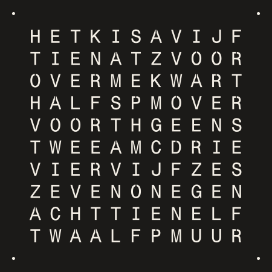

# QLOCK

A 45 × 45 cm Dutch word clock, QLOCKTWO style. 110 letters and four minute
dots, one LED behind each, printed on the Bambu Lab H2D and run by an ESP32
that gets the time over Wi-Fi.



```
front
█████░░░░░█████░░░░░█████   faceplate, 2.5 mm black. The letters are a 0.4 mm
█████     █████     █████   white skin printed into it: that is the diffuser.
  ║         ║         ║     light grid, 18 mm white: one box per letter
  ║   LED   ║   LED   ║
═════════════════════════   LED panel, 3.6 mm plywood, strips stuck on the front
     ESP32 and wiring       on the back of the panel, inside a wooden frame
```

The build in order. Tick things off on the tracker: `python3 site/serve.py`.

1. [Buy](#1-buy) the parts
2. [Print the sample](#2-print-the-sample), a small corner of the clock
3. [Build the controller](#3-controller) and flash it
4. [Test the sample](#4-test-the-sample) with five LEDs
5. [Print the clock](#5-print-the-clock)
6. [Build the LED panel](#6-led-panel)
7. [Glue the face](#7-glue-the-face)
8. [Build the frame](#8-frame-and-finish) and hang it

## 1. Buy

**Electronics, two orders** (about €80): [TinyTronics](https://www.tinytronics.nl/en),
plus €9.49 shipping to Belgium, and Amazon.de for the two parts TinyTronics
had no stock of. Ordered 11 Nov 2026.

| # | What | € |
|---|---|---|
| 1 | [ESP32-D0WDQ6 board](https://www.tinytronics.nl/en/development-boards/microcontroller-boards/with-wi-fi/esp32-d0wdq6-development-board-with-wi-fi-and-bluetooth) (micro-USB) | 7.00 |
| 1 | [WS2812B LED strip, 30 LEDs/m, 5 m reel](https://www.amazon.de/dp/B01CDTE9AW), white PCB, IP30 (Amazon) | 27.99 |
| 2 | [SN74AHCT125N level shifter](https://www.tinytronics.nl/en/components/ics-and-microcontroller-chips/ics/sn74ahct125n-4-channel-level-converter-3.3v-to-5v-14-pin-dip) (one spare) | 2.00 |
| 1 | [14-pin IC socket](https://www.tinytronics.nl/en/components/sockets/14-pins-ic-socket) | 0.35 |
| 1 | [Experiment PCB 5 × 7 cm](https://www.tinytronics.nl/en/tools-and-mounting/prototyping-supplies/experiment-pcbs/experiment-pcb-5cm*7cm-double-sided) | 0.80 |
| 1 | [5 V / 4 A power adapter](https://www.tinytronics.nl/en/power/power-supplies/5v/sunshine-power-adapter-with-dc-jack-5.5-2.1mm-5v-4a) | 10.50 |
| 1 | [DC jack to screw terminals](https://www.tinytronics.nl/en/cables-and-connectors/connectors/screw-terminals/dc-jack-female-5.5mm-to-terminal-block) | 1.00 |
| 1 | [2200 µF 25 V capacitor](https://www.tinytronics.nl/en/components/capacitors/aishi-elektrolytic-capacitor-2200uf-25v) | 0.50 |
| 1 | [100 nF ceramic capacitors](https://www.amazon.de/dp/B0GWMVTD1H), a bag of 150: you need one (Amazon) | 5.59 |
| 1 | [Resistor set](https://www.tinytronics.nl/en/components/resistors/resistors/10%CF%89-1m%CF%89-resistor-set) (you need one 470 Ω and one 10 kΩ) | 5.00 |
| 2 | [JST-XH 3-pin plug with cable and socket](https://www.tinytronics.nl/en/cables-and-connectors/cables-and-adapters/jst-compatible/jst-xh-connector-with-cable-and-pcb-connector-3-pins) (one spare) | 1.20 |
| 4 m | [Wire 0.5 mm², red](https://www.tinytronics.nl/en/cables-and-connectors/cables-and-adapters/prototyping-wires/loose-wires/wire-single-core-flexible-%C3%B82.15mm-0.5mm2-red-1m) | 4.00 |
| 4 m | [Wire 0.5 mm², black](https://www.tinytronics.nl/en/cables-and-connectors/cables-and-adapters/prototyping-wires/loose-wires/wire-single-core-flexible-%C3%B82.15mm-0.5mm2-black-1m) | 4.00 |
| 3 m | [Wire 0.5 mm², yellow](https://www.tinytronics.nl/en/cables-and-connectors/cables-and-adapters/prototyping-wires/loose-wires/wire-single-core-flexible-%C3%B82.15mm-0.5mm2-yellow-1m) | 3.00 |
| 1 | [Heat shrink kit](https://www.tinytronics.nl/en/tools-and-mounting/installation-and-mounting-material/heat-shrink-tubing/heat-shrink-tubing-kit-black) | 4.00 |
| 1 | [Micro-USB data cable](https://www.tinytronics.nl/en/cables-and-connectors/cables-and-adapters/usb/micro-usb/goobay-93918-micro-usb-cable-1m-black). It has a USB-A plug: a MacBook needs a hub or adapter | 2.25 |

One reel, so the whites match. It is ten sections of 15 LEDs, soldered end to
end. Each section gives one row of 11 with no solder joint in it, and 4 left
over: the dots, the sample and 31 spares.

**Tools, in the TinyTronics order** (about €92, skip what you can borrow)

| What | € |
|---|---|
| [Soldering iron, Atten ST-2065D](https://www.tinytronics.nl/en/tools-and-mounting/tools/soldering-irons-and-stations/atten-st-2065d-soldering-iron-65w-adjustable-temperature) + [chisel tip](https://www.tinytronics.nl/en/tools-and-mounting/soldering/soldering-tips/solder-tip-for-atten-st-2065d-chisel-1.6mm) | 32.75 |
| [Solder 0.7 mm, 100 g](https://www.tinytronics.nl/en/tools-and-mounting/soldering/consumables/solder-wire/premium-solder-wire-0.7mm-100g) (leaded: much easier; wash your hands after) | 10.50 |
| [Wire stripper, Weicon No. 5](https://www.tinytronics.nl/en/tools-and-mounting/tools/pliers-and-cutters/wire-strippers/premium-weicon-automatic-wire-stripper-no.-5) | 19.95 |
| [Side cutters](https://www.tinytronics.nl/en/tools-and-mounting/tools/pliers-and-cutters/cutters/cutting-pliers-type-170) | 4.00 |
| [Helping hands](https://www.tinytronics.nl/en/tools-and-mounting/soldering/accessories/helping-hands-with-magnifying-glass) | 5.00 |
| [Multimeter, UNI-T UT133B](https://www.tinytronics.nl/en/tools-and-mounting/tools/measuring/lcr-and-multimeters/uni-t-ut133b-multimeter), needed twice, so borrow one if you can | 20.25 |

The iron may come without a stand: rest it on something that can't burn.

**Filament**: 1 kg black and 1 kg white PLA, 1.75 mm (the clock uses about
620 g black and 560 g white, samples included). Use what the printer at work
has, or [black](https://www.123-3d.nl/123-3D-Filament-PLA-Zwart-1-75-mm-1-kg-i11621.html)
and [white](https://www.123-3d.nl/123-3D-Filament-PLA-Wit-1-75-mm-1-kg-i11622.html)
at €22.50 each.

**DIY store** (about €25)

- Superglue **gel**, about 10 g in total
- [Plywood 3.6 mm, 122 × 61 cm](https://www.hubo.be/nl/p/multiplex-122x61-cm-3-6mm/12495/): the LED panel and the front strips of the frame
- [Planed batten 18 × 44 mm, 240 cm](https://www.gamma.be/nl/assortiment/lat-geschaafd-vuren-fsc-18x44-mm-240-cm/p/B270487): the frame
- Wood glue, eight screws about 4 × 40 mm, four about 3.5 × 30 mm
- Masking tape, sandpaper, double-sided foam tape
- A saw, a drill with 3 mm and 8 mm bits

## 2. Print the sample

Bambu Studio, H2D, 0.4 mm nozzle, **0.20 mm Standard**, PLA. The files are in
`stl/`.

| Print | Files | Filament |
|---|---|---|
| **First:** the sample | `sample_faceplate` + `sample_faceplate_letters` | black + white |
| | `sample_lightgrid` | white |
| Faceplate, 4 plates | `faceplate_TL` + `faceplate_TL_letters`, and the same for `TR`, `BL`, `BR` | black + white |
| Light grid, 4 plates | `lightgrid_TL`, `TR`, `BL`, `BR` | white |

**A faceplate is two files that belong together.** Select both in one Import,
and answer **Yes** to "Load these files as a single object with multiple
parts?". In the object list, give the `_letters` part the white filament and
the other part black. The white is exactly the first two layers: in the
sliced preview, layer 1 must show every letter filled in white.

- Import at 100 %. **Never mirror or auto-orient.** The faceplates are
  mirrored on purpose: they print face-down. Turning them flat on the plate
  is fine.
- TL, TR, BL, BR say where a tile sits **seen from the front**.
- The build plate's surface becomes the front of the clock. The textured
  plate that comes with the H2D gives a fine matte face. Judge it on the
  sample.
- Two-colour plates must sit in the area both nozzles reach (300 × 320 mm),
  prime tower included. Every faceplate fits.
- Light grid: in the sliced preview, check that the thin walls on the tile
  edges are there. If they are missing, set *Wall generator* to *Arachne*.
- No supports, no brim. One plate per tile.

Print the three sample files now. The big plates come in step 5.

## 3. Controller

A small board that takes 5 V from the adapter, feeds the LEDs and the ESP32,
and lifts the ESP32's 3.3 V data signal to 5 V.

```
adapter ── DC jack ─┬─ +5 V ─┬─ 2200 µF ─┬─ chip pin 14 ───────────── strip +5 V   (red)
                    │        │  (stripe  └─ plug ─ ESP32 5.0V
                    │        │   to GND)
                    └─ GND ──┴───────────┬─ chip pin 7 ────────────── strip GND    (black)
                                         └─ plug ─ ESP32 GND

ESP32 GPIO16 ─ plug ─ chip pin 2 (and 10 kΩ from pin 2 to GND)
                      chip pin 3 ── 470 Ω ─────────────────────────── strip DIN    (yellow)
```

On the experiment PCB: the IC socket, the JST socket, both resistors and both
capacitors. Lay the big capacitor on its side: standing up it is too tall for
the frame. The chip is the SN74AHCT125N; pin 1 is left of the notch, counting
goes anticlockwise.

| Chip pin | Goes to |
|---|---|
| 14, 4, 10, 13 | +5 V |
| 7, 1, 5, 9, 12 | GND |
| 2 | ESP32 GPIO16 (through the plug), and 10 kΩ to GND |
| 3 | 470 Ω, then the strip's data input |
| 6, 8, 11 | nothing |

Solder the 100 nF capacitor straight across pins 14 and 7.

**The plug.** The JST cable goes to the ESP32: solder its three wires to the
tips of the pins marked 5.0V, GND and GP16, with a bit of heat shrink over
each. The JST socket sits on the
board. Mark which wire is which and check it with the multimeter.

**Before you connect anything:** plug the adapter into the DC jack and measure
the screw terminals. The one marked + must read +5 V.

**The USB rule: USB cable in, clock plug out.** Never have both connected.
The ESP32 is flashed over USB on its own, then plugged back into the clock.

**Flashing** (Arduino IDE):

1. Apple-silicon Mac only, once: `softwareupdate --install-rosetta --agree-to-license`.
   Without it the IDE fails with "bad CPU type".
2. Boards Manager: install **esp32** by Espressif, 3.3.x. Library Manager:
   install **FastLED**, 3.10.9 or newer.
3. Tools > Board > **ESP32 Dev Module**. Pick the port that appears when you
   plug in the board.
4. Open `firmware/led_test/led_test.ino` and press Upload. If it hangs on
   "Connecting...": this board has no BOOT button, so hold a wire between
   GP0 and GND, press RST, and let go when the upload starts.

## 4. Test the sample

The sample is the real top-right corner of the clock: **J F** above **O R**,
and the corner dot. It proves the letters, the light and your wiring before
you print a kilo of plastic.

1. Put the sample grid on a piece of board, notches down, and mark the middle
   of the four letter boxes and of the corner box.
2. Cut the first two sections off the reel, at the factory solder joints
   (side cutters). Cut each into a row of 11, to keep for step 6, and 4 left
   over. From those: two strips of two, and one single. Cut through the
   middle of the copper pads. Stick them on the marks, LEDs facing up. Seen
   from above this is the front view: J F on top, O R below, the dot top-right.
3. Wire them in this order: **J → F → R → O → dot**. The arrows on the strip
   show the direction. Red to +5 V, black to GND, yellow to DIN of the J. The
   wires to the dot go round the outside and in through the notches along
   the top.
4. Grid over the LEDs, faceplate on top, nothing glued. Plug in the ESP32,
   then the adapter. Each LED lights in turn, then all five.

Check in a dim room:

| Look for | If not |
|---|---|
| Letters glow evenly, no bright blob | Set `INLAY_T = 0.6` in `tools/make_stl.py` and re-run it, or lay a sheet of baking paper behind the faceplate |
| The black stays black | Try another black filament, or set `FACE_T = 3.0` and re-run |
| A lit letter leaves its neighbours dark | Find the gap. Usually the grid isn't flat on the LEDs: press a bit of black tack over the strip where it passes under a wall |
| You like the surface | Print the sample on another build plate |

## 5. Print the clock

The sample passed, so print the eight big plates the same way: four
two-colour faceplates and four white light grids. About 1.1 kg of PLA.

## 6. LED panel

Cut the plywood to **450 × 450 mm**. Lay it down: the side facing you is the
LED side, and you are looking at the clock from the front. H is top-left.

1. **Draw ten row lines**, measured from the top edge: 60, 96.7, 133.3, 170,
   206.7, 243.3, 280, 316.7, 353.3 and 390 mm.
2. **Cut ten strips of 11 LEDs**, one from each 15-LED section of the reel.
   Each is 366.7 mm. Cut off the plugs at both ends of the reel.
3. **Stick them on the lines**, with the middle of the first LED 58.3 mm
   from the left edge. Top row: arrows point right. Next row: arrows point
   left. Keep alternating. Stay within 1 mm of the line.
4. **Stick one single LED in each corner**, its middle 22.4 mm from both
   edges.
5. **Join the rows** with three short wires at the ends, alternating sides:
   +5 V to +5 V, GND to GND, DO to DI. Solder the wires on sideways, so they
   run straight down along the edge.
6. **Chain the dots** from the end of the bottom row: bottom-left dot, along
   the bottom to the bottom-right dot, up the right side to the top-right
   dot, along the top to the top-left dot. Tape the wires flat, 22 mm from
   the edge: that is where the grid has its wire notches.
7. **Power.** Drill an 8 mm hole 22 mm from the left edge on the top row
   line. Through it come red, black and yellow to the start of the top row,
   and a second red and black to the free end of the top-left dot, right
   beside it. That feeds the chain from both ends.
8. **Test.** Set `NUM_LEDS 114` in `led_test.ino` and flash it. All 114 light
   one by one, then together. Lay the grid tiles on, notches down: they must
   sit flat.

Stick the controller board and the ESP32 on the back of the panel with foam
tape, next to the hole.

## 7. Glue the face

1. Lay the four faceplate tiles **face up**, read the clock, and tape the
   seams tightly with masking tape. Flip the whole plate over onto a flat
   table.
2. Dry-fit the grid tiles on the back, **notches up**. From the back
   everything is mirrored: `lightgrid_TL` goes top-right. The outer edges
   line up with the faceplate, and the grid's seams are one box away from the
   faceplate's seams, so each holds the other together. No wall may cross a
   letter.
3. Run a thin line of gel along both faceplate seams. Grid walls land
   exactly on them.
4. Glue one grid tile at a time: gel along the rim, on the edge walls, and a
   dot on every wall crossing. Press it down for a minute. Peel the tape off
   the front when everything has set.

## 8. Frame and finish

A box around the clock with a lip in front, like a deep picture frame.
Measure your glued face first; these sizes assume 450 × 450 mm.

```
          front strip 30 mm wide
        ┌────────────┐
        │  ┌─────────┴──────────────
 batten │  │ face + grid   20.5 mm
 18 × 44│  │ LED panel      3.6 mm
        │  │ ▓▓ block       room for the ESP32: 20 mm
        └──┘
```

1. **Box**: two battens of 488 mm (top and bottom) and two of 452 mm between
   them, standing on edge. Glue, and two 4 × 40 mm screws per corner. Drill
   3 mm pilot holes first. The opening is 452 × 452 mm.
2. **Lip**: four strips of plywood, 30 mm wide: two of 488 mm and two of
   428 mm. Glue them on the front of the box, flush with the outside. They
   stick out 12 mm into the opening and stop well short of the dots.
3. Saw a small notch in the back edge of the bottom batten for the power
   cable. Sand, and paint or oil if you like.
4. **Fill it** from the back: the printed face, then the LED panel with the
   LEDs facing the letters. Cut four 20 mm blocks from the leftover batten
   and screw one to the inside of each side, tight against the panel
   (3.5 × 30 mm screw, pilot hole first). To open the clock later, take out
   those four screws.
5. Run the adapter cable up the back to the DC jack and tape it down.

**Go live.** Open `firmware/qlock/qlock.ino`, type your Wi-Fi name and
password at the top, and upload (USB in, clock plug out). Plug everything
back in and power up.

| The clock shows | It means |
|---|---|
| H blinks red three times, then the dots light clockwise from top-left | Start-up check. If a different letter blinks, flip `STARTS_LEFT` or `STARTS_TOP` in the sketch. If the dots go round the wrong way, reorder `DOTS` |
| H pulses amber | No time yet. If it never stops, check the Wi-Fi name and password |
| The time in warm white | All good. It dims from 23:00 to 07:00 |
| HET IS in violet | No contact with the time server for a day |

Later updates need no cable: the clock appears in the Arduino IDE as network
port **qlock**. Don't commit your Wi-Fi password.

**Hang it** on two screws in the wall, under the top batten.

## The tracker

```bash
python3 site/serve.py
```

Opens a checklist of this guide in your browser, with the shopping list, the
wiring picture and the LED map. Ticks are saved in `site/progress.json`.
Add `--lan` to open it on your phone too.

## What is in this folder

```
README.md            this guide
site/                the tracker
stl/                 the print files, and preview.svg
firmware/led_test/   lights every LED: for the sample and for the finished panel
firmware/qlock/      the clock
tools/               only needed if you change the design
```

To change a dimension, edit the numbers at the top of `tools/make_stl.py` and
run it. It rewrites `stl/` and checks every file: solid, fits the printer,
reads correctly from the front.

```bash
python3 -m venv .venv && .venv/bin/pip install -r tools/requirements.txt
.venv/bin/python tools/make_stl.py
python3 tools/check_firmware.py     # runs the clock code for all 1440 minutes
```
